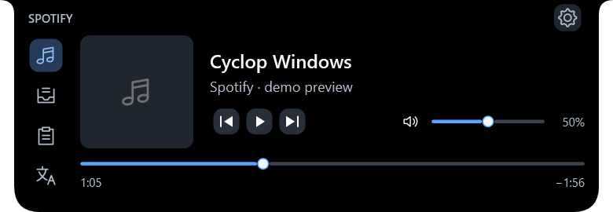
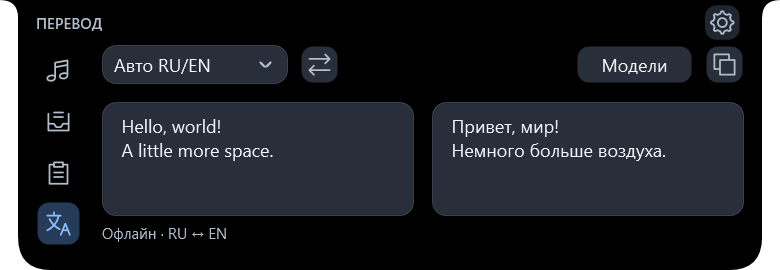

# Cyclop Windows

*[English](README.md) · Русский*

Компактная панель у верхней границы экрана: Spotify, файлы, история буфера и офлайн-перевод. Нативное приложение для Windows 11 на C# и WPF.

Это **неофициальная независимая Windows-адаптация** [Cyclop](https://github.com/akalikbergenov/cyclop) автора [@akalikbergenov](https://github.com/akalikbergenov). Идея и дизайн вдохновлены оригинальным проектом; этот порт не является его официальным выпуском.

[](https://github.com/garifulinandrej183-lang/cyclop-windows/actions/workflows/windows.yml)
[](https://buymeacoffee.com/akalikbergenov)



*Windows-интерфейс с демонстрационными данными. Автор оригинальной идеи и иконки приложения — @akalikbergenov.*

**[Скачать последнюю версию](https://github.com/garifulinandrej183-lang/cyclop-windows/releases/latest)** — Windows 11 x64.

## Возможности

| Вкладка | Что делает |
|---|---|
| **Spotify** | Показывает обложку, трек и время из поддерживаемой настольной или Store-сессии Spotify; управляет воспроизведением и громкостью Spotify, когда Windows сообщает о доступности действий. Браузерное воспроизведение не используется. |
| **Полка** | Хранит ссылки на файлы для быстрого доступа и перетаскивания; по отдельному выбору сохраняет скопированные изображения или наблюдает за папкой скриншотов. Удаление карточек сохраняет оригиналы. |
| **Буфер** | После включения записывает текст и ссылки. Доступны поиск, закрепление, восстановление, пауза и очистка. История защищена Windows DPAPI для текущего пользователя. |
| **Перевод** | Переводит русский и английский локально на CPU после явной загрузки или импорта обеих закреплённых моделей Argos. Модели не входят в пакет приложения. |



Наведите курсор на верхнюю центральную полоску выбранного экрана или нажмите **Ctrl+Alt+Space**. **Escape** закрывает панель; **Ctrl+1–4** выбирают вкладку. Клавишу и монитор можно изменить в настройках. Автозапуск выключен до явного включения.

## Установка

Скачайте portable ZIP или Setup для текущего пользователя со страницы выпуска. ZIP нужно распаковать целиком и запустить `Cyclop.exe`, сохранив файлы рядом. Setup устанавливает приложение для текущего пользователя. Пакеты автономны: для запуска не нужны .NET SDK, установленный Python или права администратора.

Приложение и установщик **не подписаны**, поэтому Windows может показать предупреждение безопасности. Для перевода нужно явно скачать или импортировать модели в настройках; после установки перевод использует локальные файлы. Остальные вкладки работают без моделей. Источники, контрольные суммы и сведения о лицензировании моделей приведены в [документации перевода](docs/TRANSLATION.md).

## Данные и приватность

Запись истории буфера по умолчанию выключена. После включения она сохраняет только текст и ссылки и учитывает поддерживаемые признаки исключения буфера; пароли автоматически не распознаются. Автосохранение изображений включается отдельно: PNG остаются обычными незашифрованными файлами. Настройки и ссылки полки не относятся к зашифрованной истории. Очистка истории не удаляет сохранённые PNG и оригиналы файлов полки.

Данные пользователя находятся в `%LOCALAPPDATA%\CyclopWindows`. Подробнее: [буфер и полка](docs/CLIPBOARD.md), [интеграция Spotify](docs/SPOTIFY.md).

## Сборка

Для сборки нужны Windows 11 x64, PowerShell 7, закреплённый .NET SDK **10.0.403**, Python **3.12.14 x64** и Inno Setup **7.1.0** (также поддерживается совместимый 6.7.3). Для запуска готового выпуска эти инструменты не нужны.

```powershell
.\build.ps1
.\test.ps1
.\tools\build-worker.ps1
.\test.ps1 -PythonTests
.\publish.ps1 -SkipWorkerBuild
```

Подробности — в [инструкции сборки](docs/BUILDING.md). Автоматические проверки не заменяют [ручную приёмку](docs/MANUAL-TESTS.md), включая реальные действия Spotify, буфер и скриншоты, несколько физических мониторов и чистую установку Windows. Также доступны [заметки о портировании](docs/PORTING.md).

## Благодарности

Спасибо [@akalikbergenov](https://github.com/akalikbergenov) за оригинальный [Cyclop](https://github.com/akalikbergenov/cyclop), идею, дизайн и открытый исходный код. Адаптация опирается на upstream-коммит `125eb02fbd28b443fe922334ae09823d4ad38df6`. Можно [поддержать автора оригинала](https://buymeacoffee.com/akalikbergenov).

Лицензия — [MIT](LICENSE); сведения о зависимостях — в [уведомлениях третьих сторон](THIRD-PARTY-NOTICES.md).
